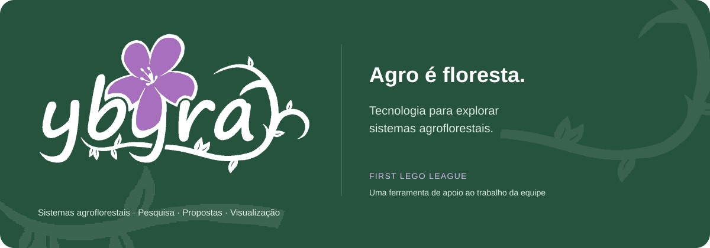
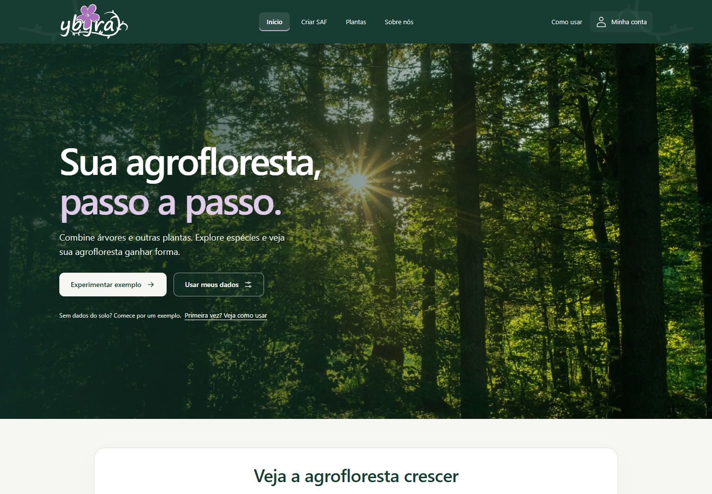

<div align="center">



**Robótica, pesquisa e agrofloresta. Uma ideia da equipe Jumpers, do SESI Cotia.**

[Acessar o site](https://ybyra-sesi-fll.vercel.app) · [Executar localmente](#executar-localmente) · [Guia técnico](docs/GUIA-TECNICO.md) · [Produção](docs/PRODUCAO.md)

</div>

## Sobre o ybyrá

O ybyrá apoia o projeto de inovação dos Jumpers na FIRST LEGO League. A ferramenta permite explorar espécies, comparar propostas de Sistemas Agroflorestais (SAFs) com dados de clima e solo e acompanhar uma evolução ilustrativa em anos e meses.

O projeto reúne **79 registros de plantas**, incluindo o inventário histórico compartilhado pelo **Grupo Taiobas do Matão USP**. As propostas e os desenhos de crescimento usam um subconjunto de **18 espécies**. O catálogo distingue registros de consulta, hipóteses e dados efetivamente usados pelo modelo.

> As propostas são educativas. Os cenários e limiares de solo são demonstrativos e não substituem laudo, avaliação agronômica ou planejamento de campo. Dados ausentes permanecem explícitos.

## Conheça a experiência



| Explorar                                     | Entender                                      | Conhecer                                         |
| -------------------------------------------- | --------------------------------------------- | ------------------------------------------------ |
| Cenários e formulário em três etapas         | Propostas com justificativas e fontes         | Catálogo pesquisável e relações entre espécies   |
| Representação das fases com plantas e raízes | Controle manual, seleção e movimento reduzido | Sobre nós, fotos da equipe e carrossel acessível |

Qualquer pessoa pode simular. Para guardar e reabrir propostas em **Minha conta → Meus SAFs**, entre com e-mail e senha ou, quando configurado, com Google. O cadastro por e-mail em produção exige senha com pelo menos 12 caracteres e confirmação por código.

## Executar localmente

É necessário **Python 3.10 ou mais recente**. O servidor usa somente a biblioteca padrão; os arquivos da interface já estão compilados.

```sh
python servidor.py
```

Abra [localhost:8765](http://127.0.0.1:8765) e experimente um cenário. No Windows, também é possível usar `py servidor.py`. Encerre com `Ctrl+C`.

O modo local usa SQLite em `.dados-locais/`, não envia e-mail e abre a sessão ao cadastrar. Na produção, a confirmação por e-mail é obrigatória antes do login. Contas locais e de produção são independentes.

**Use o servidor do projeto:** abrir HTML diretamente ou usar Live Server não aplica a proteção de contas e arquivos.

## Tecnologias e responsabilidades

| Camada                  | Tecnologia                                          | Responsabilidade                                              |
| ----------------------- | --------------------------------------------------- | ------------------------------------------------------------- |
| Páginas e regras        | HTML, CSS, JavaScript e JSON                        | Formulário, catálogo, composição e animação do SAF            |
| Componentes interativos | React, TypeScript, shadcn/ui, Radix, Embla e Lucide | Abas, acordeão, ampliação de fotos e carrossel                |
| Build da interface      | Vite e Tailwind CSS                                 | Compilar as ilhas React, sem substituir o site inteiro        |
| Servidor                | Python                                              | Autenticar requisições e entregar arquivos protegidos         |
| Contas locais           | SQLite                                              | Senhas com hash e sessões locais                              |
| Produção                | Vercel, Supabase e Brevo SMTP                       | Hospedagem, PostgreSQL, autenticação e confirmação por e-mail |

A composição do SAF acontece no navegador. O servidor consulta o Open-Meteo para obter médias municipais da reanálise ERA5 de 1991 a 2020. O formulário também aceita médias informadas manualmente. A simulação atual fica na aba, e o histórico da conta guarda as entradas, a composição selecionada e o mês visualizado.

## Desenvolver e validar

Para alterar os componentes React, instale Node.js compatível com Vite 7 (20.19+ ou 22.12+) e execute:

```sh
npm ci --prefix frontend
npm run check --prefix frontend
npm run build --prefix frontend
```

Edite `frontend/src/`; o build atualiza `sistema-agroflorestal/ui/`. Os arquivos compilados são versionados para permitir executar o servidor sem Node.js.

```sh
python -m unittest discover -s tests -v
node --test tests/crescimento.test.mjs tests/recomendacao.test.mjs
```

Para alterações visuais, confira também navegação, formulário, login, carrossel e crescimento em computador e celular.

## Estrutura

```text
api/                     Adaptador Python da Vercel
frontend/                Fontes React/TypeScript e configuração do build
sistema-agroflorestal/    Páginas, estilos, módulos JS, dados e assets do site
  ui/                    Saída compilada; não editar manualmente
supabase/                Migração SQL e template de confirmação de e-mail
tests/                   Testes Python e Node
docs/                    Arquitetura, produção, pesquisa, créditos e evidências
  fontes/                Documento original do inventário do parceiro
servidor.py              Servidor e autenticação SQLite de desenvolvimento
auth_producao.py         Integração da autenticação com Supabase
```

## Produção e segurança

O [guia de produção](docs/PRODUCAO.md) explica Supabase, SMTP, variáveis e Vercel. Use `.env.example` como referência; nunca versione senhas, chaves secretas, sessões ou bancos locais.

A configuração da Vercel encaminha as rotas para `api/site.py`. As páginas, o catálogo e a simulação são públicos. A API de histórico exige sessão, inclusive ao abrir uma proposta salva por link.

## Equipe, parceria e créditos

Os Jumpers são uma equipe de robótica do SESI Cotia formada por 11 integrantes e pela Thalita, professora, orientadora técnica e mentora da equipe. O Grupo Taiobas do Matão USP compartilhou o banco de sementes de 2021 que apoia a pesquisa. O [documento original](docs/fontes/banco-sementes-taiobas-2021.docx) e seu [inventário rastreável](docs/INVENTARIO-ORIGINAL-TAIOBAS.json) permanecem no repositório.

As fotografias da equipe foram fornecidas pelo time. A fotografia de floresta da abertura e as imagens do catálogo têm fontes e licenças registradas nos [créditos](docs/CREDITOS-IMAGENS.md). A imagem ilustrativa da tela de acesso é gerada e identificada como tal. As marcas das instituições são preservadas nos assets.

[Guia técnico](docs/GUIA-TECNICO.md) · [Identidade visual](docs/IDENTIDADE-VISUAL.md)

## O que é necessário?

Para executar localmente: Python, os arquivos do servidor e a pasta `sistema-agroflorestal/`. `frontend/` só é necessário para editar e recompilar os componentes. Node.js não é necessário para usar a interface já compilada.

Para publicar: `api/`, `vercel.json`, `.python-version` e a configuração de produção. `supabase/` guarda o SQL e o modelo de e-mail. `docs/` e `tests/` são referências e verificações, não são carregados pelo site.

`.dados-locais/` contém contas locais e `.vercel/` contém a ligação com a hospedagem; preserve essas pastas. `__pycache__`, `.ruff_cache` e dependências locais não são arquivos do site e são ignorados pelo Git.
