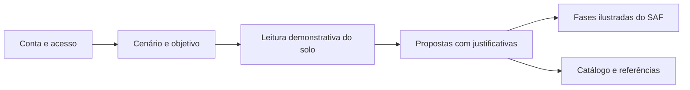
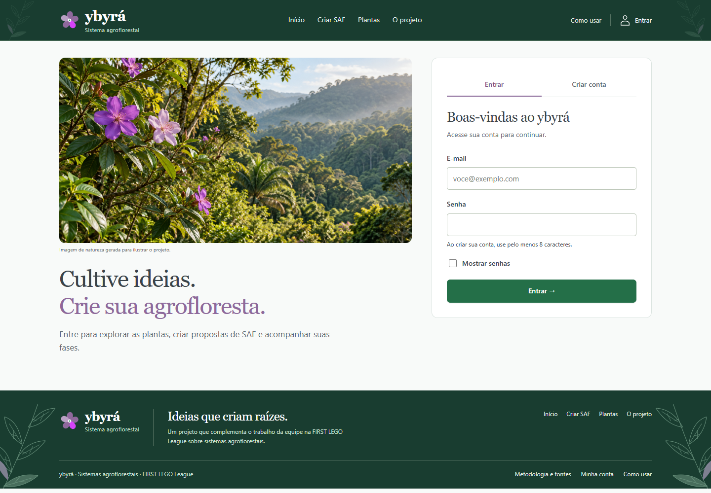
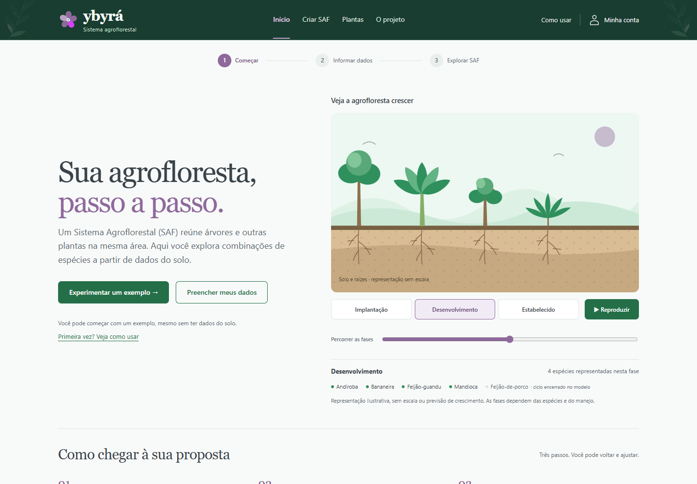
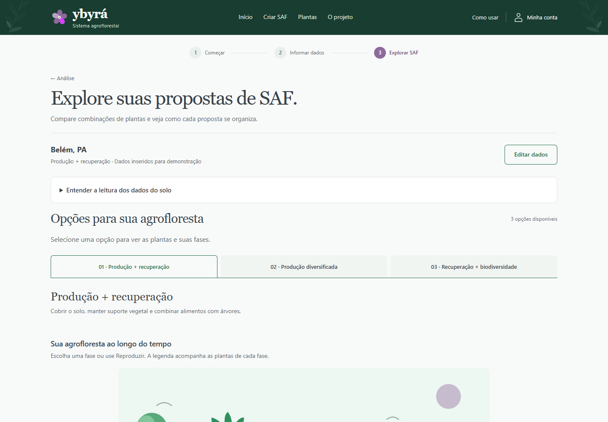
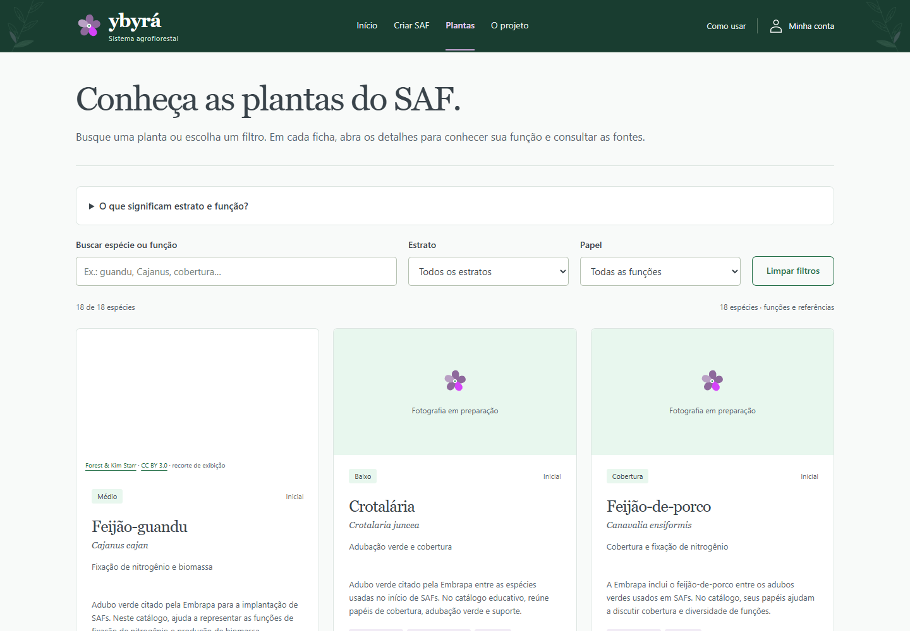
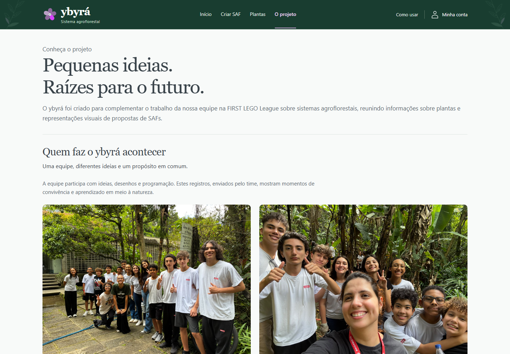

<div align="center">


**Um apoio digital ao trabalho da equipe na FIRST LEGO League sobre sistemas agroflorestais.**

[Conheça o projeto](#o-projeto) · [Veja a experiência](#a-experiência-em-imagens) · [Execute localmente](#executar-localmente) · [Guia técnico](docs/GUIA-TECNICO.md)


</div>

## O projeto

O **ybyrá** foi criado para complementar o trabalho da equipe na **FIRST LEGO League** sobre **Sistemas Agroflorestais (SAFs)**. Ele reúne informações sobre plantas, organiza propostas de composição agroflorestal e representa suas fases visualmente, apoiando a exploração e a apresentação das ideias do time.

A experiência parte de uma pergunta: **como transformar informações sobre o solo e as funções das plantas em uma proposta de SAF que possa ser explorada e explicada?** O usuário informa um cenário, consulta sugestões e vê os motivos de cada escolha. O catálogo e as referências permitem continuar a investigação.

O foco é o projeto de agrofloresta da equipe. A programação é o meio usado para construir essa ferramenta; o ensino de computação não é o objetivo central do produto.

> **Protótipo em evolução.** As propostas usam regras demonstrativas, com limites explícitos. Não constituem um planejamento agronômico validado nem substituem avaliação técnica de campo.

## Do cenário à proposta

| Etapa | O que acontece |
| :--- | :--- |
| **01 · Acessar** | Criar uma conta com e-mail e senha e entrar no sistema. |
| **02 · Informar** | Experimentar um cenário fictício ou preencher localização, condições do solo e objetivo em três etapas. |
| **03 · Explorar** | Consultar propostas, espécies, funções e explicações sobre as escolhas. |
| **04 · Visualizar** | Percorrer uma representação das fases do SAF, com plantas e raízes. |
| **05 · Investigar** | Explorar o catálogo de 18 espécies, suas fichas e as fontes consultadas. |



A representação das fases nasceu de um protótipo criado por um integrante da equipe. Ela ajuda a visualizar a organização do sistema, sem prever tempo de crescimento, produtividade ou recuperação de nutrientes.

## A experiência em imagens

Capturas reais da aplicação local. As telas protegidas foram registradas com uma conta temporária de demonstração.

| Entrada e cadastro | Início e orientação |
| :---: | :---: |
|  |  |
| Acesso obrigatório com e-mail e senha. | Um caminho para experimentar ou informar os próprios dados. |

| Propostas agroflorestais | Catálogo de plantas |
| :---: | :---: |
|  |  |
| Composições acompanhadas de motivos e limites. | Espécies, funções, imagens e referências para consulta. |

<details>
<summary><strong>Ver a página do projeto e da equipe</strong></summary>



</details>

## Uma identidade construída com o time

O nome **ybyrá** foi escolhido pela equipe pela associação com árvore em tupi-guarani. A marca combina o nome com uma flor estilizada de **manacá-da-serra**. As folhas, a fotografia de natureza e os detalhes roxos e verdes conectam a interface ao tema do projeto.

| Roxo | Magenta | Cinza | Menta | Verde |
| :---: | :---: | :---: | :---: | :---: |
| `#8E699C` | `#D543F9` | `#39434A` | `#72FFB0` | `#2F905D` |

As ideias do time aparecem na navegação, no catálogo com imagens, na representação do SAF crescendo e na página que apresenta o projeto. O cabeçalho e o rodapé foram inspirados no modelo visual enviado por uma aluna.

[Conheça a marca vetorial](sistema-agroflorestal/assets/logo-ybyra.svg) · [Veja a página do projeto](sistema-agroflorestal/historia.html)

## Como funciona

| Parte | Tecnologia | Responsabilidade |
| :--- | :--- | :--- |
| Interface | HTML, CSS e JavaScript | Páginas, formulário, catálogo e ilustração das fases. |
| Propostas | JavaScript e arquivos JSON | Aplicação de regras locais e explicação dos resultados. |
| Acesso | Python, biblioteca padrão | Cadastro, login, sessões e proteção das páginas e dados. |
| Contas | SQLite | E-mail, hashes de senha e sessões em banco local. |

A análise é processada no navegador. O servidor cuida do acesso e entrega os arquivos protegidos. Não há dependência de serviços externos para gerar propostas; algumas fotos do catálogo e os links de referência exigem internet.

### O que já está disponível

- Cadastro, login, logout e navegação protegida por sessão.
- Formulário em etapas, cenários demonstrativos e guia de uso.
- Propostas com justificativas e representação ilustrativa das fases.
- Catálogo de 18 espécies com busca, fichas e referências.
- Identidade ybyrá, layout responsivo e página da equipe.

**Ainda não implementados:** perfil editável, modos de tema e histórico de projetos por usuário. A análise atual fica no navegador e é removida ao entrar ou sair da conta; ela não funciona como histórico permanente.

### O que os resultados significam

Os cenários e limiares de solo são demonstrativos. N, P e K usam unidades arbitrárias, sem equivalência com um laudo de laboratório. Dados desconhecidos permanecem ausentes; a falta de um registro não comprova compatibilidade entre espécies. As propostas não definem espaçamento, densidade ou manejo e não confirmam adequação regional.

A curadoria reúne referências da Embrapa, acessíveis na [metodologia e fontes](sistema-agroflorestal/sobre.html). As fontes sustentam os conceitos e funções indicados; não validam automaticamente as regras numéricas do protótipo.

## Executar localmente

**Requisito:** Python 3.10 ou mais recente. Não é necessário instalar pacotes Python ou usar Node.js.

Na pasta do repositório:

```sh
python servidor.py
```

No Windows, se o comando disponível for o inicializador Python, use `py servidor.py`.

Abra [ybyrá no navegador](http://127.0.0.1:8765), escolha **Criar conta** e informe e-mail e senha de pelo menos oito caracteres. Depois, experimente um dos cenários pela página inicial. Para encerrar o servidor, use `Ctrl+C` no terminal.

**Por que um servidor se as páginas são HTML?** O HTML apresenta as telas. O servidor verifica quem está conectado, cadastra contas e protege as páginas e os dados. Abrir o HTML com duplo clique ou usar um servidor estático não executa essa autenticação.

O banco é criado em `.dados-locais/ybyra.sqlite3`, fora da pasta pública e ignorado pelo Git. Esta versão não envia confirmação ou recuperação de senha por e-mail. O servidor foi preparado para testes locais; publicação exige configuração apropriada de HTTPS e autenticação.

[Detalhes de contas, segurança, edição e testes →](docs/GUIA-TECNICO.md)

## Estrutura do repositório

```text
Projeto-SESI-FLL-2026/
├── README.md                     # Apresentação do projeto
├── servidor.py                   # Servidor local e autenticação
├── docs/
│   ├── GUIA-TECNICO.md            # Execução, dados, créditos e manutenção
│   └── imagens/                  # Capa e capturas da aplicação
├── sistema-agroflorestal/
│   ├── *.html                    # Páginas do sistema
│   ├── assets/                   # Marca, ícones, fotos e ilustrações
│   ├── css/                      # Estilos e identidade visual
│   ├── dados/                    # Espécies, cenários e regras em JSON
│   └── js/                       # Interações e geração das propostas
└── tests/                        # Testes da autenticação e proteção de rotas
```

## Autoria e referências visuais

O ybyrá incorpora ideias, desenhos e protótipos enviados pela equipe para complementar seu trabalho na FIRST LEGO League. As fotografias da equipe foram fornecidas pelo próprio time. A imagem de natureza da tela de entrada foi gerada e é identificada como ilustrativa. As fotos externas do catálogo têm créditos nas fichas.

[Créditos e referências completos](docs/GUIA-TECNICO.md#identidade-imagens-e-autoria) · [Projeto de referência para a apresentação deste README: Vaggu](https://github.com/Pietro-August0/Vaggu)
