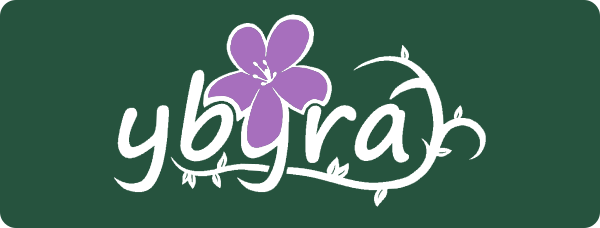

# Identidade visual do ybyrá

A identidade usa a logo enviada pela equipe: escrita desenhada, flor de manacá-da-serra e ramos com folhas integrados às letras. Os contornos foram extraídos da ilustração original para arquivos SVG editáveis, preservando a assinatura em vez de substituí-la por uma fonte.

## Versões e aplicações

| Arquivo                                                                                                                                 | Uso                                                             |
| --------------------------------------------------------------------------------------------------------------------------------------- | --------------------------------------------------------------- |
| [Logo positiva](../sistema-agroflorestal/assets/marca/logo-positiva.svg)                                                                | Letras e ramos verdes em fundos claros.                         |
| [Logo negativa](../sistema-agroflorestal/assets/marca/logo-negativa.svg)                                                                | Letras e ramos brancos em fundos escuros; cabeçalhos e rodapés. |
| [Logo monocromática](../sistema-agroflorestal/assets/marca/logo-monocromatica.svg)                                                      | Aplicações em uma cor.                                          |
| [Flor](../sistema-agroflorestal/assets/marca/flor.svg) e [flor negativa](../sistema-agroflorestal/assets/marca/flor-negativa.svg)       | Símbolo isolado em espaços pequenos.                            |
| [Ramos verdes](../sistema-agroflorestal/assets/marca/raizes.svg) e [brancos](../sistema-agroflorestal/assets/marca/raizes-negativa.svg) | Ornamentos extraídos do ramo lateral da própria logo.           |
| [Ramo inferior](../sistema-agroflorestal/assets/marca/ramo-inferior.svg)                                                                | Detalhe extraído da base da assinatura.                         |

Os elementos chamados de raízes na aplicação reproduzem os ramos com folhas da ilustração. Mantenha a proporção original, espaço livre ao redor e contraste com o fundo. Não separe a flor das letras na assinatura completa nem altere as posições de suas pétalas. Os SVGs têm fundo transparente.

## Cores

| Aplicação                         | Cor                                                   |
| --------------------------------- | ----------------------------------------------------- |
| Fundo e letras verdes da marca    | `#26533E`                                             |
| Pétalas da marca                  | `#A76FBD`                                             |
| Letras da versão negativa         | `#FFFFFF`                                             |
| Paleta escolhida para a interface | `#8E699C`, `#D543F9`, `#39434A`, `#72FFB0`, `#2F905D` |

O verde e o roxo da marca foram amostrados da imagem enviada. A paleta da interface permanece nos botões, estados e destaques.

## Favicons e ícones

A flor original aparece em uma base verde para continuar reconhecível em tamanhos pequenos.

- [Favicon SVG](../sistema-agroflorestal/assets/marca/favicon.svg), PNG de 16, 32 e 48 pixels e ICO com esses três tamanhos.
- [Ícone Apple](../sistema-agroflorestal/assets/marca/apple-touch-icon.png), 180 × 180 pixels.
- [Ícone 192](../sistema-agroflorestal/assets/marca/icone-192.png) e [ícone 512](../sistema-agroflorestal/assets/marca/icone-512.png).
- [Manifesto](../sistema-agroflorestal/assets/marca/site.webmanifest) com nome, cores e ícones. O manifesto não acrescenta funcionamento offline.

Todas as sete páginas declaram os ícones. A logo completa aparece nos cabeçalhos e rodapés; a versão positiva também apresenta a identidade na página do projeto. Os caminhos antigos da logo e dos ícones continuam disponíveis com os desenhos atualizados.

## Originais e autoria

Os dois JPEGs recebidos estão preservados em [originais](../sistema-agroflorestal/assets/marca/originais/). O JPEG de fundo claro contém letras brancas; use a versão positiva SVG para apresentar a marca sobre branco.

A logo foi fornecida pela equipe do ybyrá. Esta atualização prepara suas aplicações digitais para o projeto que complementa o trabalho da equipe na FIRST LEGO League sobre sistemas agroflorestais.

## Instituições e parceiro de pesquisa

As logos do SESI, da FIESP e da FIRST LEGO League foram enviadas pela equipe e preservadas em `assets/instituicoes/`, junto ao símbolo e à assinatura Taiobas do Matão. O rodapé das sete páginas identifica instituições, participação na FLL e parceria de pesquisa. A página do projeto também apresenta a marca do Taiobas junto ao texto da colaboração.

O template de confirmação usa a paleta do ybyrá e `assets/marca/logo-email.png`, uma renderização PNG da versão negativa SVG para compatibilidade com aplicativos de e-mail. As marcas institucionais mantêm suas cores originais. O código é texto selecionável no e-mail; os botões de copiar e colar funcionam na página de conta, pois o e-mail não executa JavaScript.

[Voltar à apresentação](../README.md) · [Guia técnico](GUIA-TECNICO.md)

## Refinamento de uso no site — 29/10/2026

A interface passou a usar floresta #173d32, ação #245b43, lilás #765888 e fundos #f6f7f3 / #eee8f2 / #e9efe5. A marca original permanece intacta. Os tokens da interface estão em `sistema-agroflorestal/css/experiencia.css`; a integração shadcn está documentada em [Reforma da interface](REFORMA-INTERFACE.md).
